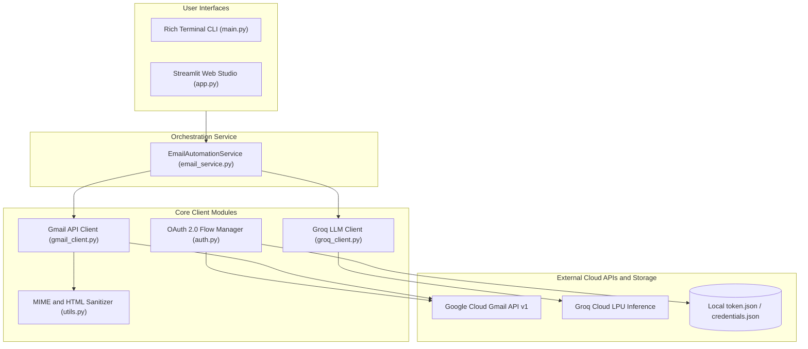

# AI-Powered Email Automation System

An enterprise-grade, autonomous email intelligence platform combining the **Google Gmail API** with ultra-fast LLM inference powered by the **Groq API**. The platform reads incoming communications, extracts executive summaries and action items, detects sentiment and urgency, drafts or sends context-aware replies.

---

<a id="table-of-contents"></a>
## Table of Contents

- [Project Overview](#project-overview)
- [Key Features](#key-features)
- [Architecture](#architecture)
- [Repo Structure](#repo-structure)
- [Tech Stack](#tech-stack)
- [Quickstart and Installation](#quickstart-and-installation)

---

<a id="project-overview"></a>
## Project Overview

Modern professionals and organizations spend over 28% of their workweek managing inboxes. Critical action items are frequently buried within long message threads, leading to delayed responses, missed deadlines, and cognitive fatigue.

The **AI-Powered Email Automation System** solves this challenge by operating as an intelligent copilot and autonomous worker. By pairing Google's secure OAuth 2.0 infrastructure with Groq's high-speed inference engine, the system:
- Ingests raw multipart email streams and strips complex HTML into pristine plain text.
- Parses emails into structured executive summaries, categorized priorities, and actionable to-do lists.
- Dynamically drafts context-aware replies matching chosen professional tones.
- Provides a safe "Human-in-the-Loop" workflow staging responses as Gmail drafts or autonomously sending verified replies in-thread.

<p align="right"><a href="#table-of-contents">Back to Top</a></p>

---

<a id="key-features"></a>
## Key Features

- **Deep Inbox Ingestion and Parsing**: Connects via Gmail API v1 to fetch unread or queried messages, cleanly handling multipart MIME payloads and HTML-to-text sanitization.
- **Groq AI Structured Intelligence**:
  - **Executive Summary**: 2-3 sentence high-impact summary.
  - **Action Items Extraction**: Detects commitments, deadlines, and required deliverables.
  - **Classification**: Categorizes into *Work*, *Personal*, *Urgent*, *Finance*, *Notification*, or *Support*.
  - **Priority and Sentiment Scoring**: Identifies urgency and sender emotional tone.
- **Context-Aware Smart Replies**:
  - Generates replies tailored to specific tones: *Professional*, *Concise*, *Friendly*, or *Assertive*.
  - One-click prompt presets (*Acknowledge and Thank*, *Confirm Meeting*, *Politely Decline*, *Request More Details*).
  - Preserves RFC 2822 email threading headers (`In-Reply-To`, `References`, and `threadId`).
- **Human-in-the-Loop Safety**: Defaults to staging generated responses directly as **Gmail Drafts**, giving users complete oversight before sending.
- **AI Polish Drafting Studio**: Enhances rough thoughts or bullet points into executive-level prose.
- **Autonomous Batch Processing**: Scans incoming unread batches, filters by priority, and creates draft responses in bulk.
- **Dual Interface**:
  - **Streamlit Web Studio**: Responsive dual-pane master-detail feed, interactive checklist cards, and real-time telemetry.
  - **Rich Terminal CLI**: Interactive console menus, tables, and direct single-command automations.

<p align="right"><a href="#table-of-contents">Back to Top</a></p>

---

<a id="architecture"></a>
## Architecture

The system is organized into modular decoupled layers: Interface, Orchestration Service, Core Clients, and External Cloud APIs.



### Component Flow:
1. **Authentication**: `auth.py` validates `credentials.json` against Google OAuth 2.0 endpoints, refreshes expired tokens, and writes authorized session states to `token.json`.
2. **Data Extraction**: `gmail_client.py` retrieves message payloads; `utils.py` decodes base64url data and extracts clean text from complex HTML DOM trees.
3. **Cognitive Analysis**: `groq_client.py` constructs structured prompts with JSON schema validation, calling Groq LPUs for near-instant inference with automatic fallback models.
4. **Execution and Staging**: `email_service.py` coordinates whether the output is dispatched directly into the email thread or staged in Gmail Drafts.

<p align="right"><a href="#table-of-contents">Back to Top</a></p>

---

<a id="repo-structure"></a>
## Repo Structure

```
Gmail_AI_Project/
├── .streamlit/
│   └── config.toml            
├── src/
│   ├── __init__.py          
│   ├── auth.py                 # Google OAuth 2.0 flow and token persistence
│   ├── gmail_client.py         # Gmail API wrapper(read, send, draft, labels)
│   ├── groq_client.py          # Groq AI client(summarization, replies, polish)
│   ├── email_service.py        # Central orchestrator coordinating Gmail and Groq
│   └── utils.py                # MIME decoders, HTML-to-text, string truncation
├── .env.example                
├── .gitignore                 
├── app.py                      # Streamlit Web Dashboard
├── config.py                   
├── main.py                     
├── requirements.txt           
└── README.md                   
```

<p align="right"><a href="#table-of-contents">Back to Top</a></p>

---

<a id="tech-stack"></a>
## Tech Stack

### Core Technologies
- **Language**: Python 3.11+
- **Email Gateway**: Google Gmail API v1 (`google-api-python-client`, `google-auth-oauthlib`, `google-auth-httplib2`)
- **AI / LLM Engine**: Groq Cloud API (`groq`) utilizing high-throughput LPUs (`openai/gpt-oss-120b`, `openai/gpt-oss-20b`, `qwen/qwen3.8-27b`)
- **Frontend Framework**: Streamlit (Modern master-detail cards, segmented controls, metrics)
- **Text and Payload Processing**: BeautifulSoup4 (`bs4`), Python standard `email.mime`, `base64`
- **Environment Management**: Python-dotenv (`dotenv`), Pathlib

<p align="right"><a href="#table-of-contents">Back to Top</a></p>

---

<a id="quickstart-and-installation"></a>
## Quickstart and Installation

### 1. Prerequisites
- Python 3.11 or higher
- A Google Cloud Console project with the **Gmail API** enabled
- A free [Groq Cloud API Key](https://console.groq.com/keys)

### 2. Clone the Repository
```bash
git clone https://github.com/yasaswivenkat/Gmail_AI_Project.git
cd Gmail_AI_Project
```

### 3. Initialize Virtual Environment
```powershell
# Windows (PowerShell)
python -m venv .venv
.venv\Scripts\Activate.ps1

# Linux / macOS
python3 -m venv .venv
source .venv/bin/activate
```

### 4. Install Dependencies
```bash
pip install -r requirements.txt
```

### 5. Configure Credentials
1. **Google Cloud Console (`credentials.json`)**:
   - Go to [Google Cloud Console](https://console.cloud.google.com/).
   - Enable **Gmail API** in *APIs & Services > Library*.
   - Configure **OAuth consent screen** (User type: *External*, add your Gmail under *Test users*).
   - Go to *Credentials > Create Credentials > OAuth client ID > Desktop app*.
   - Download the client secrets file, rename it to `credentials.json`, and place it in the project root.

2. **Environment Variables (`.env`)**:
   - Copy `.env.example` to `.env`:
     ```bash
     cp .env.example .env
     ```
   - Insert your Groq API key:
     ```env
     GROQ_API_KEY=gsk_your_groq_api_key_here
     GROQ_MODEL=openai/gpt-oss-120b
     ```

### 6. Run the Application

#### Option A: Streamlit Web Dashboard
```bash
streamlit run app.py
```
Open **http://localhost:8501** in your browser to access the interactive web workspace.

#### Option B: Interactive Terminal CLI
```bash
# Launch interactive menu
python main.py

# Or run direct commands
python main.py --action status
python main.py --action summarize --limit 5
python main.py --action send --to "recipient@example.com" --subject "Status" --body "All tasks complete."
python main.py --action auto-reply --limit 5
```

<p align="right"><a href="#table-of-contents">Back to Top</a></p>

